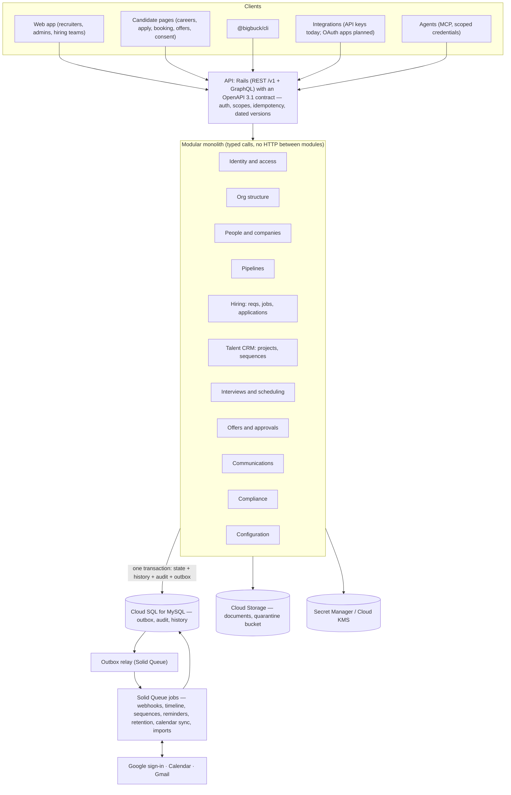
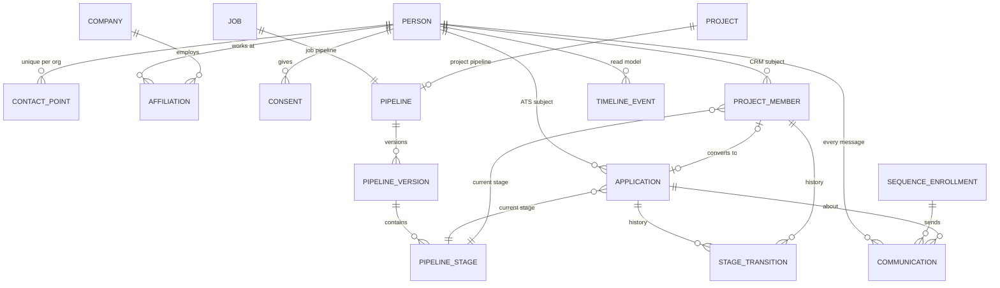

# 31 — Architecture

How the one platform is put together: the services, the table spine the ATS and CRM share, the design rules every module follows, sizing, the repository layout and the provider interfaces. What gets built and when is in [`build-plan.md`](./build-plan.md).

## Architecture



One Rails app serves the API and runs the Solid Queue workers (webhook delivery, outbox relay, timeline, sequences, retention) against one MySQL database. A module becomes its own service only when measured load requires it.

## The shared spine: how the ATS and CRM tables align

The CRM is not bolted onto the ATS. Both are built from the same few shapes, so a sourced prospect, an applicant and a hire are the same row moving through the same machinery.



| Shared shape | ATS uses it for | CRM uses it for | Tables |
|---|---|---|---|
| **Person** | Applicants, hires | Prospects, alumni, referrals | `people`, `person_contact_points`, `companies`, `person_affiliations` |
| **Pipeline subject** | `applications` | `project_members` | Both carry `pipeline_version_id`, `current_stage_id`, `status`, `version`, `sync_version`; both write `stage_transitions` (exactly one subject per row) |
| **Pipeline** | Job pipelines (`scope = job`) | Project pipelines (`scope = project`) | `pipelines`, `pipeline_overrides`, `pipeline_versions`, `pipeline_stages`; templates per `object_type` |
| **Communication** | Confirmations, rejections, offers, reminders | Sequence steps, replies, logged calls | `communications` (every message, both directions), `scheduled_messages` (the outgoing queue), `reply_addresses` |
| **Timeline** | Stage changes, interviews, notes | Pool adds, outreach, replies | `timeline_events`, rebuilt from the outbox |
| **Classification** | Jobs, requisitions, postings | People, projects | `dimensions`, `dimension_values`, `entity_dimension_values`, custom fields |
| **Compliance gate** | Apply form, provider-run interviews | Pool adds, sequence enrollment, outreach | One policy engine, one `consents` history |
| **Change record** | Every write | Every write | `audit_events`, `outbox_events`, `config_revisions` |

Rules that keep them aligned:

1. **Tenant-safe foreign keys.** Every tenant table has `unique (organization_id, id)`, and every reference between tenant tables is a composite foreign key on `(organization_id, <ref>_id)`. MySQL has no row-level security, so the tenant default scope (`TenantScoped`, fails closed when no tenant is set) stops one tenant reading another's rows, and composite keys stop a bug from *linking* one tenant's application to another tenant's person.
2. **One person per human per organization.** `person_contact_points` is unique on `(organization_id, kind, normalized_value)`. How new records attach to existing people is rule 2 below.
3. **Two pipeline subjects, one shape.** Anything that works on an application's stage (guards, transitions, automations, reporting by stage `type`) works on a project member the same way. Conversion links the two (`project_members.converted_application_id`, `applications.source_project_member_id`), so sourcing attribution survives into hiring reports.
4. **One message table.** Whether a message is an interview confirmation or the third step of a sequence, it is one `communications` row tied to the person, so the timeline, replies, unsubscribes and retention treat them identically.
5. **Same conventions on every table:** UUID string ids, `organization_id` with the `TenantScoped` default scope, `version` on mutable aggregates, audit on every write, append-only history enforced by triggers or restricted roles.

## Design rules

Each rule is also written into the doc named.

| # | Rule | Where |
|---|---|---|
| 1 | Composite tenant foreign keys, as above | [`db/structure.sql`](../db/structure.sql), [`build-plan.md`](./build-plan.md#mysql-principles) |
| 2 | **Matching people.** An exact email match attaches a new application or pool member to the existing person but never overwrites that person's fields; new values are added as extra contact points or offered as suggestions. Phone, URL and name matches only create merge suggestions. A person whose lifecycle is `employee` or `alumni` is matched only by a verified email or by a user. | [`data-model.md`](./data-model.md#contact-point) |
| 3 | **Who can see a person.** A user sees a person if they can see any of that person's applications or project memberships, or if they hold `person.read` with an org-wide scope and the person is not restricted. Confidential applications and restricted projects never make a person visible, and never reveal that the person exists, to anyone outside their access list. Search, timeline, dedup responses and suggestions all apply the same rule. | [`permissions.md`](./permissions.md#person-visibility) |
| 4 | **Incremental sync is for unscoped readers.** In v1, `sync_token` is accepted only from credentials whose read scope on that resource is org-wide. A row's visibility can change without the row changing (a job is retagged, a scope is edited), so scoped credentials would silently miss or keep rows. Scoped credentials use the events feed plus periodic full reads. | [`api-strategy.md`](./api-strategy.md#incremental-sync) |
| 5 | **Short write transactions.** Background work (imports, config re-resolution, retention, bulk moves) commits in chunks of at most 500 rows or 2 seconds, so no transaction holds back the sync watermark for every tenant. Pool and Cloud SQL session timeouts back it up. | [`db/structure.sql`](../db/structure.sql) |
| 6 | **Webhooks are at-least-once and unordered.** Every event carries `subject.version`; consumers keep the highest version they have seen. Ordering is kept inside Big Buck (timeline, projections), not promised to consumers. | [`api-strategy.md`](./api-strategy.md#delivery-guarantees) |
| 7 | **Personal data in history.** Every column and custom field has a `data_class` (`pii`, `sensitive`, `internal`). Audit rows record which `pii` fields changed and a hash, never the values. Outbox rows are deleted after the 30-day replay window, and erasure redacts a person's outbox rows inside it. Webhook delivery logs keep status, latency and a response snippet, never request bodies. Request logs never contain bodies. Read models (timeline, search) are rebuilt without the person. Backups age out with the 7-day recovery window, which is documented as the erasure lag. | [`db/structure.sql`](../db/structure.sql), [`consent-and-compliance.md`](./consent-and-compliance.md) |
| 8 | **Legal hold.** A hold on a person, application or job pauses retention and erasure for everything it covers until it is released, and the pause is logged. | [`consent-and-compliance.md`](./consent-and-compliance.md#legal-hold) |
| 9 | **Uploads are scanned.** Resumes and attachments land in a quarantine bucket and are readable only after a malware scan passes (`documents.scan_status`). | [`db/structure.sql`](../db/structure.sql) |
| 10 | **Plans conflict per object, not per organization.** A plan records the version of every object it changes; apply is refused only if one of those objects changed since. A UI edit to a message template no longer invalidates a pipeline plan. | [`recruiting-as-code.md`](./recruiting-as-code.md#apply) |
| 11 | **One condition language, one template language.** Conditions in guards, approval policies, compliance policies and automations are a closed structured YAML rule schema (not CEL, not eval'd code), type-checked at `validate` ([`decisions.md`](./decisions.md#decided-2026-10-25)). Messages and offer letters use Liquid syntax; `.docx` letters are rendered with a template library behind the letter interface. | [`recruiting-as-code.md`](./recruiting-as-code.md#file-format), [`build-plan.md`](./build-plan.md#if-rules) |
| 12 | **Sending and tracking through Gmail.** Candidate mail goes out through the Gmail API from a connected mailbox: the recruiter's own (`personal`) or a shared company mailbox such as recruiting@ (`shared`). Big Buck syncs both and stores only messages whose participants match a person in Big Buck, so replies reach the timeline and stop sequences. Each mailbox's Google daily cap (2,000 messages) is enforced by the send queue. Big Buck's own notifications to users go through a transactional provider from Big Buck's domain, never to candidates. | [`candidate-communications.md`](./candidate-communications.md#sending-and-replies) |
| 13 | **Public endpoints are hardened.** The apply, booking, offer and consent pages use a bot challenge, per-posting and per-IP limits, upload scanning and single-use expiring tokens. | [`api-strategy.md`](./api-strategy.md#resource-map) |
| 14 | **Hidden means quiet.** A hidden record answers `404`, never `403`. A new record that collides with a hidden person is created normally, keeping the value as a held duplicate, with a merge suggestion only someone who can see both people receives. Candidates always have the same experience as everyone else. | [`permissions.md`](./permissions.md#person-visibility) |
| 15 | **Confidential jobs, sourcing and their messages.** Confidential jobs and sourcing projects, their applications and members, and their messages are visible only to their access lists, omitted from lists, search and counts for everyone else, scheduled as private calendar events under a code name, and sent only to integrations with the `confidential:read` scope. Synced mail takes its thread's visibility; mail that cannot be placed is treated as confidential; offer-stage mail is private. A contact cooldown across all sequences stops two teams emailing the same person, with one message that reveals nothing. | [`permissions.md`](./permissions.md#confidential-jobs), [`permissions.md`](./permissions.md#confidential-sourcing), [`candidate-communications.md`](./candidate-communications.md#confidential-communication) |

## Scale targets and production sizing

Targets, not measurements. The load test that proves them is v2 work ([`decisions.md`](./decisions.md#decided-2026-10-24-later-the-same-day)); v1 is built to them:
- 1,000 organizations on one regional deployment
- 10 million applications, 50 million people, 100 million timeline events
- API read p95 under 200 ms and write p95 under 400 ms at 500 requests per second
- scheduling suggestions for a five-interview panel in under 3 seconds
- an outbox lag under 5 seconds at p99

Starting production shape:

| Piece | Starting configuration |
|---|---|
| Cloud SQL | Enterprise edition, high availability, 4 vCPU and 16 GB, point-in-time recovery for 7 days. A read replica serves reporting and search once they compete with writes. No shared-core instances: they carry no SLA |
| Connections | A pool of 10 per API instance and a ceiling on instances, so the total stays inside the database's connection budget; the tenant is set per request (`Current.organization_id`), not in the database session |
| Cloud Run | One Rails image: `api` with at least 2 instances and a `worker` (Solid Queue, including the outbox relay) scaling with queue depth |
| Pub/Sub, Cloud Scheduler | Inbound Gmail push notifications; timed work. Retryable jobs run in Solid Queue |
| Cloud Storage | Documents, a quarantine bucket for unscanned uploads, exports with lifecycle rules |
| Secret Manager, Cloud KMS | OAuth tokens, webhook secrets, signing keys |
| Documents pipeline | A quarantine bucket whose finalize notifications go to a Pub/Sub topic pushed to the `worker`; ClamAV (`clamd`) as an internal Cloud Run service; a documents bucket readable only through signed URLs. The worker accepts pushes only from the Pub/Sub service account's OIDC token |

Rough cost for this shape is a few hundred dollars a month for the database and well under that for the rest at low volume; price it in the GCP calculator before committing.

Planned: partition `audit_events`, `outbox_events`, `webhook_deliveries`, `timeline_events`, `communications` and `stage_transitions` by month, with retention aligned to the partitions. Not yet in `db/structure.sql` (#60 item 7).

## Repository layout

```text
app/
  controllers/  REST /v1 controllers and the GraphQL controller
  graphql/      schema, types, mutations, persisted queries
  models/       ActiveRecord models (TenantScoped on every tenant table)
  services/     commands, guards, policies; the domain logic, no HTTP
  jobs/         Solid Queue jobs (webhooks, outbox relay, imports, scans)
config/         Rails config, routes, CORS
db/             migrations and structure.sql (MySQL)
openapi/        OpenAPI 3.1 contract
mcp/            MCP tools generated from the contract
sdk/            TypeScript SDK over /v1
cli/            bigbuck CLI over the SDK
web/            Remix 3 recruiter app and candidate pages
research/       product and design docs
test/           Minitest suites, including test/ci conventions
```

Migrations are Rails migrations dumped to `db/structure.sql` (not `schema.rb`) so MySQL-specific details such as triggers and composite keys survive.

## Provider interfaces

Every outside service sits behind an internal interface, so v1's choices can be swapped or joined later without touching the domain modules:

| Interface | v1 implementation | Later |
|---|---|---|
| Identity | Google sign-in | SAML and SCIM (v2) |
| Mailbox | Gmail send and sync | Outlook |
| Calendar | Google Calendar and Meet | Microsoft 365 |
| Signature | Click-to-accept | DocuSign, Dropbox Sign, Adobe Acrobat Sign |
| Importer | Generic CSV | Vendor-specific importers |
| Notifications | Transactional email from Big Buck's domain (provider not yet chosen; logs until then, see [`decisions.md`](./decisions.md#open-decisions)) | Slack |
| Bot challenge | reCAPTCHA Enterprise on the public endpoints | Another challenge provider |
