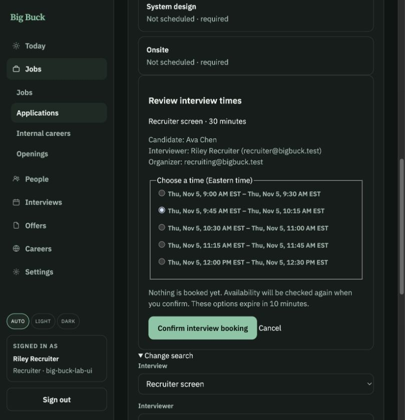

# Candidate workflow review — November 4, 2026

Tested in the local Big Buck UI sandbox using the Codex browser. Riley Recruiter moved Ava Chen through Platform Engineer; Harper Manager completed the assigned offer approval. All feedback entered during this walkthrough was explicitly labeled as simulated local UI testing.

## Verified workflow

Applied → Onsite → Offer → Hired.

Within Onsite, booked and submitted the required rubric feedback for Recruiter screen, Coding, System design, and Onsite. Created a $150,000 draft offer, submitted it, approved it as Harper, and generated the offer letter as Riley. Recorded the final hire through the recruiter UI and verified its stage history.

The sandbox deliberately blocks anonymous candidate acceptance. This walkthrough used the existing manual-hire policy; it did not sign an offer as the candidate or change that policy. Candidate acceptance and accepted-offer requirements were covered by backend regression tests.

## Failures fixed

- The job board requested a query with complexity 2,616 against a limit of 400. Twenty-candidate pages now stay within the API limit and are combined by the web controller. A backend test exercises a second page using the registered browser query.
- Navigation changed the URL without updating the screen. The installed Remix runtime threw a MutationObserver error during top-frame navigation. The app now uses Remix’s documented full-document navigation mode while continuing to hydrate interactive components. HMR also refreshes the document.
- Job-loading errors were masked as “Job not found.” Unexpected loading errors now produce an explicit error page and retry route.
- Stage failures were reduced to “422.” The API client retains problem details, and missing feedback is explained with a recovery path to the candidate.
- Scheduling hardcoded `hm`, and self-scheduling hardcoded `screen`. These now use the current stage’s interview definitions. Booking records use the application’s current stage instead of hardcoded `onsite`.
- Demo booking called an unconfigured external calendar backend directly. Calendar event creation now follows the sandbox capture path.
- Scheduling ignored saved interviewer working hours and local bookings. It now respects saved time zones, working windows, paused profiles, existing bookings, and buffers. Slot rounding moves forward rather than before the requested start. The first screen created before this fix remains at 4 a.m. in the test history; subsequent bookings were at 9 a.m. or later.
- Scorecard forms displayed every rubric and raw keys. Each interview now uses its own rubric, named attributes, and required ratings.
- Refreshing a successful form could repeat a write. Candidate moves, feedback, bookings, offer creation, submission, and approval now use post/redirect/get with one-time notices. An end-to-end regression verifies that refreshing after a move adds no duplicate history entry.
- Offer approval always used an override. The screen now identifies the assigned approver and exposes normal approval to that person. Offer and candidate controls follow the signed-in role’s permissions.

- Interview booking now has a read-only preview and explicit confirmation. Signed proposals expire after ten minutes, bind the application, stage, pipeline version, actor, attendees, and organizer, and recheck availability. A stale slot is refused without automatically booking another time. Refreshing preview creates no interviews; refreshing confirmation keeps a single booking.

## Recruiter usability

The original candidate page felt like a collection of API forms: it defaulted to an earlier stage, offered a salary field before interviews, and gave no explanation for blocked progression. The revised page shows the complete journey, selects the next configured stage, lists outstanding feedback, and puts offer work ahead of completed interview history when the candidate reaches Offer. The board opens with all stages visible; section filters remain available. Selecting an interviewer resolves their email from the hiring team.

Further work worth doing:

1. Expand time selection beyond the first five proposed slots and support recruiter-selected display time zones. The new review step already lets recruiters inspect attendees, choose a time, change their search, or cancel before booking.
2. Allow editing submitted feedback and show existing notes alongside ratings. The current page primarily supports first submission.
3. Improve dense board operations: candidate search, clearer selection feedback, and a move control that stays visible on long pipelines.
4. Restore frame navigation after the upstream runtime issue is diagnosed or upgraded. Full-document navigation is a verified recovery, with the usual full-page reload tradeoff.
5. Preserve generated scheduling/acceptance links across refreshes without issuing them again. Those link-producing forms still render their result directly.

## Validation

- Complete web suite: 50 tests passed, including Chromium end-to-end tests. The cancellation regression was rerun after the final correction.
- Complete Rails suite against the committed SQL schema in an isolated database: 276 tests passed, 4,885 assertions. Final proposal/panel tests were also rerun after preserving reviewed pool attendees.
- Targeted backend workflow suite: 22 tests passed, 136 assertions.
- Additional proposal/panel regressions: 10 tests passed, 65 assertions, including signed-token expiry, stale slots, changed stages, repeat confirmation, and preserving reviewed pool attendees.
- MCP suite: 8 tests passed; MCP TypeScript and tenant-isolation checks passed.
- Strict TypeScript checking passed.
- Live browser walkthrough verified persisted stage changes, four feedback submissions, assigned approval, offer generation, and manual hire.

The follow-up Codex browser check used a refreshed sandbox (generation 4): moved Ava to Onsite, reviewed five proposed times, chose the second option at 9:45 a.m. Eastern on November 5, confirmed it, and verified one scheduled interview after refresh. The earlier full hire walkthrough was in generation 3, which has since refreshed.
